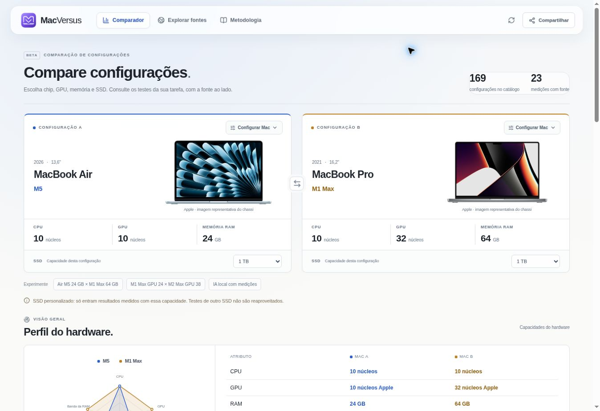

# MacVersus

Comparador de configurações de MacBooks, em português, com fotografias oficiais, gráficos e rastreabilidade até a publicação original. O catálogo inicial cobre as famílias MacBook Pro de 2019 a 2026, incluindo Intel, M1 a M5, Pro e Max, além do Air M1 medido e das configurações do Air M5. A navegação usa materiais de vidro inspirados na linguagem visual da Apple; o conteúdo dos testes permanece legível.



## O que já funciona

- Seleção encadeada por família, chip, tamanho de tela, GPU, CPU e RAM, com opções de SSD documentadas pela Apple.
- Preset do exemplo Air M5 24 GB/1 TB contra M1 Max GPU 32/64 GB/1 TB.
- Perfil em radar com capacidades reais de CPU, GPU, RAM, SSD e largura de banda. Cada eixo tem escala própria e não representa uma nota de desempenho.
- Comparação visual de jogos, IA local e aplicativos de criação.
- FPS, tokens por segundo, tempo de render/exportação e pontuações com unidades explícitas.
- Fichas técnicas com links oficiais da Apple. GPU e VRAM dos Intel são tratadas separadamente da memória unificada dos Apple Silicon.
- Detalhes de cada medição: hardware testado, condições, informações ausentes, publicação original e data.
- Compartilhamento da seleção por URL e exportação CSV com fontes.
- Descoberta de novas publicações pela API Tavily, quando configurada.
- Até três ofertas verificadas por configuração exata no Brasil, ordenadas pelo preço à vista, com loja, condição, frete separado, link e data. A base inicial possui cinco anúncios revisados; nem toda configuração possui oferta.
- Filtro por todas as condições, novos ou usados/seminovos, e links para OLX, Mercado Livre, eBay, Shopee e Google Shopping. A opção inicial inclui novos e usados.
- Busca opcional de anúncios candidatos, separada do ranking verificado. Um anúncio internacional revisado em USD está incluído como referência, com envio e custo final para o Brasil a conferir.
- Atualização de preços nas páginas previamente revisadas que fornecem os campos necessários. URLs de busca não se tornam ofertas automaticamente.
- Base de benchmarks atualizável por JSON revisado local e feed remoto opcional, com validação, cache, botão de consulta e preservação da base anterior quando a atualização falha.
- Sem chave, consulta às fontes já pesquisadas e links externos de pesquisa, identificados claramente.
- Interface responsiva, navegação por teclado, diálogos acessíveis, animações e respeito à preferência de movimento reduzido.

## Regras dos dados

**O catálogo de hardware é maior que a base inicial de benchmarks.** A presença de um Mac na lista não significa que exista uma medição publicada para todas as tarefas.

Os números iniciais foram transcritos de testes do Notebookcheck e de relatos identificados na discussão de benchmarks do projeto llama.cpp. As especificações vêm de páginas oficiais da Apple. A base inclui publicações históricas, cuja data permanece visível; a data de consulta não representa uma nova execução do teste.

Não há geração de FPS ou tokens/s por IA, extrapolação por núcleos de GPU, atribuição de testes de Mac Studio a MacBook Pro ou transferência automática de resultados entre configurações com RAM ou SSD diferentes. Um SSD não informado não equivale a um SSD de 1 TB. Também não há média global misturando jogos e aplicativos.

Crimson Desert, Xcode, DaVinci Resolve, Final Cut, exportação de dados e leitura/gravação de SSD já podem ser selecionados como alvos de pesquisa. A presença no seletor não afirma que exista um benchmark: esses protocolos novos começam sem medição revisada. As 23 medições iniciais são identificadas por máquina, unidade, data e condições; nenhuma delas é uma previsão para os Macs mais recentes.

Um percentual e um vencedor só podem ser exibidos quando os dois registros possuem o mesmo protocolo, condições documentadas e nenhuma informação ausente. Os registros iniciais com condições incompletas permanecem sinalizados como parciais, mesmo quando os números foram publicados. Jogos em Windows/Boot Camp têm esse ambiente identificado e não são tratados como equivalentes aos testes em macOS.

A descoberta na web retorna publicações, não transforma resumos de busca em medições. Inclusão no comparador exige conferir a fonte e registrar o protocolo. Consulte [a documentação das fontes](docs/sources.md).

## Executar localmente

Requer Node.js 22 ou superior; Node.js 24 é a versão usada no desenvolvimento.

```sh
npm ci
npm run dev
```

Abra `http://localhost:3000`.

Para validar e executar o build de produção:

```sh
npm test
npm run typecheck
npm run build
npm start
```

## Prévia no GitHub Pages

A versão estática mantém seleção de configurações, radar, benchmarks incluídos, fontes, compartilhamento e exportação CSV. Pesquisa integrada, feed remoto e atualização de preços exigem o servidor Next.js. Na prévia, esses recursos usam a base publicada e links externos com indicação explícita; ofertas vencidas após 24 horas deixam de aparecer no ranking.

Para gerar os arquivos estáticos:

```sh
node scripts/build-preview.mjs
```

O resultado fica em `docs/index.html` e seus arquivos associados, com base `/MacVersus/`. A fonte preparada para publicação é **Settings > Pages > Deploy from a branch > main > /docs**. A existência desses arquivos não significa que o Pages já esteja ativado. Consulte [a verificação e os limites da prévia](docs/verification.md).

## Pesquisa na internet

Copie `.env.example` para `.env.local` e configure `TAVILY_API_KEY` no servidor. A chave não é enviada ao navegador. A documentação do provedor está em https://docs.tavily.com/documentation/api-reference/endpoint/search.

O campo opcional `RESEARCH_ACCESS_TOKEN` permite restringir a pesquisa integrada de publicações e anúncios. Quando configurado, o visitante informa esse token no respectivo painel de pesquisa. Ele permanece apenas na memória da página; a aplicação não o grava no armazenamento do navegador.

A comparação e o catálogo funcionam sem essas variáveis. Sem a chave Tavily, a interface informa que está consultando as fontes da base e oferece pesquisas externas. Esta versão não possui um crawler autônomo nem atualização automática dos benchmarks.

As buscas integradas usam cache de cinco minutos, limite de resultados, timeout e limitação por processo. Para disponibilizar a pesquisa paga em uma implantação pública com várias instâncias, configure proteção de acesso e um limitador compartilhado. Consumo e limites do provedor dependem da conta configurada.

## Atualizar dados e preços

O botão de atualizar a base consulta a versão revisada disponível no servidor. O feed remoto opcional `BENCHMARK_DATA_URL` permite publicar dados novos sem alterar a interface; aceita JSON público versionado em `raw.githubusercontent.com`, com cache de até dez minutos. O repositório do aplicativo pode continuar privado. Sem feed remoto, `src/data/reviewed-updates.json` acompanha a versão local. Consulte [o formato e o processo de revisão](docs/updating-data.md).

O validador confere estrutura, referências e consistência. A confiabilidade das medições continua dependendo da revisão da publicação original. Resumos de busca e requisitos mínimos de jogos nunca são tratados como medições da configuração escolhida.

Ofertas vencem após 24 horas. O botão de atualizar preços consulta somente produtos e variantes previamente revisados, com identificadores exatos. Ausência de estoque, moeda, preço à vista ou configuração suficiente impede a inclusão. O ranking considera o preço anunciado sem frete e pode misturar condições, sempre identificadas. Ele é o menor preço entre as ofertas conferidas, não uma promessa de cobertura de todas as lojas. Consulte [as fontes de mercado](docs/market-sources.md).

O botão de pesquisar mais ofertas faz uma descoberta opcional pela Tavily, restrita aos quatro marketplaces. Os resultados são candidatos para conferência: resumos não comprovam RAM, GPU, SSD, preço, estoque ou condição. Seus links nunca entram no atualizador de preços. O anúncio internacional revisado mantém a moeda original e fica fora do ranking BRL; seu preço observado é ocultado após 24 horas, preservando o link para nova consulta. No Pages, funcionam os links externos e os candidatos já incluídos na publicação.

Não há workflows de CI ou GitHub Actions criados neste projeto. O código e a prévia compilada podem ser enviados pela integração do GitHub. A implantação interna do Pages é executada pelo próprio GitHub, conforme sua configuração de publicação.

## Organização

| Caminho | Responsabilidade |
| --- | --- |
| `src/app` | Página, estilos e rotas HTTP do Next.js |
| `src/components` | Comparador, seleção de hardware, pesquisa e detalhes |
| `src/data/catalog-devices.ts` | Variantes de hardware baseadas em fichas da Apple |
| `src/data/catalog.ts` | Medições, protocolos e fontes iniciais de Apple Silicon |
| `src/data/intel-benchmarks.ts` | Medições e ambientes de execução dos Intel |
| `src/lib/comparison.ts` | Regras de comparabilidade, unidades e CSV |
| `src/lib/research.ts` | Validação, pesquisa externa, cache e proteção |
| `src/lib/types.ts` | Contrato dos dados |
| `src/lib/configuration.ts` | SSD, correspondência exata e capacidades do radar |
| `src/lib/dataset-updates.ts` | Feed revisado, validação e atualização da base |
| `src/lib/offers.ts` | Correspondência, validade, preços e atualização de anúncios |
| `src/lib/offer-discovery.ts` | Descoberta opcional, limites e separação dos anúncios candidatos |
| `src/lib/marketplace-links.ts` | Consultas externas compartilhadas entre servidor e prévia |
| `src/data/offers.ts` | Anúncios revisados e evidências |
| `src/data/offer-candidates.ts` | Candidatos internacionais revisados, fora do ranking BRL |
| `public/brand` | Ícone MV e logotipo em SVG |
| `public/images` | Fotografias oficiais otimizadas em WebP |
| `scripts/build-preview.mjs` | Geração local da prévia estática |
| `docs/index.html` e `docs/assets` | Arquivos preparados para o GitHub Pages |
| `tests` | Comparações, integridade da base e comportamento da pesquisa |

## APIs

`GET /api/benchmarks` devolve a base. Os filtros opcionais são `category=games|llms|apps` e `deviceIds=id1,id2`.

`POST /api/research` recebe `category`, `deviceIds` e `query` opcional. A resposta informa `mode: live` para consultas ao provedor e `mode: catalog` para fontes da base. Erros são retornados com status HTTP e a propriedade `error`.

`GET /api/offers?deviceId=ID&storageGb=1024&condition=all` retorna até três ofertas exatas. `condition` aceita `all`, `new` ou `used`, com filtro antes do ranking. `POST /api/offers` recebe `{deviceId, storageGb, condition, action: "refresh"}` para revisar produtos conhecidos, ou `action: "discover"` para localizar candidatos. A descoberta responde com `mode: live` ou `mode: links` e usa a mesma proteção de acesso da pesquisa. SSD explicitamente desconhecido (`storageGb=unknown` no GET ou `null` no POST) solicita uma seleção; somente a ausência do campo herda o SSD do catálogo. Nenhuma rota aceita uma URL arbitrária para buscar preços.

## Acrescentar medições

1. Cadastre ou encontre a configuração exata da máquina, incluindo GPU e RAM.
2. Cadastre a fonte com link e datas. Confira se o dado é uma medição, e não uma previsão do autor.
3. Defina a tarefa e a unidade. Geração de texto e processamento de prompt são tarefas diferentes; pontuação não é tempo em segundos.
4. Registre sistema, versões, resolução, preset, modelo, quantização e demais condições aplicáveis. Campos desconhecidos devem continuar desconhecidos.
5. Use `quality: partial` e `missingFields` para condições ausentes. Um `comparabilityKey` igual, sozinho, não autoriza calcular vantagem.
6. Execute os testes de integridade antes de publicar a alteração.

Nenhum banco de dados é necessário. A aplicação completa pode ser executada em um servidor Node.js compatível com Next.js. A prévia do GitHub Pages contém os recursos que funcionam no navegador; pesquisa integrada e atualização pela rede permanecem na aplicação com servidor.

## Documentação técnica utilizada

- Next.js: https://nextjs.org/docs/app/getting-started/installation
- Route Handlers: https://nextjs.org/docs/app/getting-started/route-handlers
- Tavily Search: https://docs.tavily.com/documentation/api-reference/endpoint/search
- Identificação de MacBooks Pro: https://support.apple.com/en-us/108052

Fotos e créditos: [documentação de imagens](docs/image-sources.md). Referência de interface: https://developer.apple.com/design/human-interface-guidelines/materials.

MacVersus é um projeto independente, sem vínculo com a Apple ou com os autores das medições.
